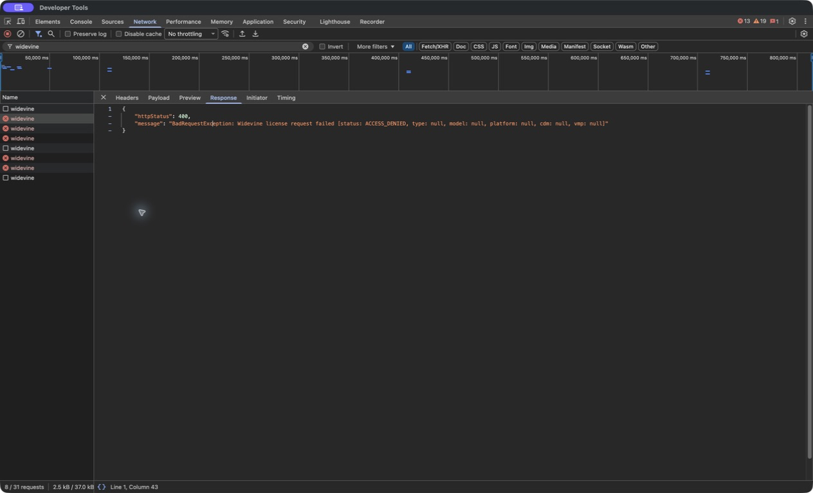
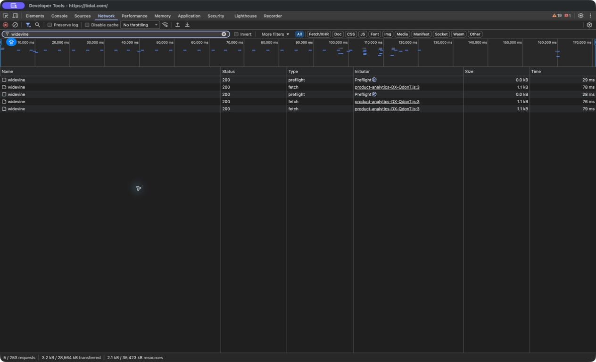

# macOS playback and production Widevine signing

The macOS 8.1.3 package could log in to TIDAL but failed to play music with error `S6007`. Its Castlabs Electron framework carried a development-only Widevine VMP certificate. Replacing that certificate through Castlabs EVS restored playback in the same app copy: the license requests changed from HTTP 400 `ACCESS_DENIED` to HTTP 200, and music played successfully.

VMP means Verified Media Path. It lets Widevine verify the software handling protected audio. Castlabs is the company that supplies the Electron build used here; EVS is its production VMP signing service. The maintainer uses EVS when preparing a release. People installing the signed app do not need an EVS account or signing tools.

## Observed failure

The investigation used tidal-hifi 8.1.3 on macOS arm64, Electron `43.0.0+wvcus`, Chromium `150.0.7871.46`, and Widevine CDM `4.10.3050.0`. The same TIDAL account could play music in a normal browser. In the wrapper, the ad blocker was off and the selected controller was `mediaSessionController`.

After pressing Play, TIDAL's web player sent:

```http
POST https://api.tidal.com/v2/widevine
Content-Type: application/octet-stream
```

The server returned HTTP 400 with this message:

```text
BadRequestException: Widevine license request failed
[status: ACCESS_DENIED, type: null, model: null,
 platform: null, cdm: null, vmp: null]
```

The line breaks above are for readability. The player then displayed `There was an unexpected error. Try again later. (S6007)`.



The response's null fields do not identify the certificate problem by themselves. The decisive additional evidence came from the official `castlabs-evs` 1.3.2 verifier:

```text
ValidityError: Certificate is valid for development only
```

## What happens after login

tidal-hifi loads TIDAL's website into its bundled Electron browser. The website handles authentication and media-license requests. The wrapper adds desktop controls and integrations.

In `src/main.ts`, startup waits for the browser components before creating the player window:

```typescript
await components.whenReady();
initialize();

setupAdBlock();
Logger.log("components ready:", components.status());

initializeWindowAndServices();
```

`createWindow()` loads the configured TIDAL URL:

```typescript
mainWindow.loadURL(tidalUrl);
```

The selected controller delegates playback to the web player's controls. For example, `MediaSessionController` contains:

```typescript
play(): void {
  this.fallbackDomController.play();
}
```

TIDAL's web player then requests the Widevine license. The browser's Widevine component needs an accepted license before it can play protected media. That separate request explains why login and browsing worked while playback failed.

The optional Express server in `src/features/api/index.ts` provides local playback and settings controls. It is not a music-streaming or licensing backend. The unimplemented `TidalApiController` is a separate experimental controller and was not selected in this test.

## What was missing from the Mac release

The project uses Castlabs Electron, but Castlabs distributes its standard browser binaries with development VMP signatures. Production use requires production signing through EVS. Installing Widevine successfully does not change the browser framework's development certificate into a production certificate.

The existing Mac release job runs `npm run build-mac` and then packages the app. There was no production VMP signing hook in that path. The desktop UI and dependency updates therefore did not resolve this signing requirement.

Apple code signing, notarization, and quarantine handling serve different purposes. They determine aspects of macOS application identity and launchability. They do not issue a production Widevine VMP signature. Removing a quarantine attribute can allow an app to open while leaving this playback failure intact.

## Verified correction

A separate copy of the installed app received an EVS production streaming signature. The official verifier then reported:

```text
Signature is valid: streaming, 1411 days left
```

The signed copy was reopened with `open`. The player code, TIDAL account, and endpoint stayed the same during the comparison. Three captured Widevine fetch requests returned HTTP 200 with nonempty license responses. Playback advanced past 77 seconds, and audible music was confirmed. A different track was also observed during the session.



The screenshot distinguishes the actual `fetch` requests from CORS `preflight` requests. A successful preflight alone would not establish that TIDAL issued a license.

The installed app's original framework binary was compared with the tested copy before applying the same signature to it. The binaries matched. The original development signature was backed up, and the installed app then passed production-signature verification too.

This identifies the cause and correction for this macOS package. It does not establish that every TIDAL `S6007` report has the same cause.

## Maintainer release setup

These instructions are for the maintainer or release operator. EVS registration must not become an installation requirement for listeners.

1. Create a free project-maintainer EVS account using the [official EVS instructions](https://github.com/castlabs/electron-releases/wiki/EVS). Install `castlabs-evs` in a Python environment and authenticate that environment. Existing accounts use `python -m castlabs_evs.account reauth`.
2. Set `TIDAL_HIFI_EVS_PYTHON` to that environment's Python executable when it is not the default `python3`.
3. Build the production-signed Mac packages with `npm run build-mac-vmp`.
4. Verify the app extracted from the final ZIP or DMG before publishing it.

For example, after the maintainer has authenticated the EVS client:

```sh
export TIDAL_HIFI_EVS_PYTHON="/path/to/evs-environment/bin/python"
npm run build-mac-vmp
node scripts/macos-vmp.cjs verify "/path/to/extracted/tidal-hifi.app"
```

The new configuration selects an `afterPack` hook:

```yaml
extends: ./build/electron-builder.yml
afterPack: ./scripts/macos-vmp.cjs
```

On macOS, VMP signing must happen before Apple signing and archive creation. The hook awaits signing, then verifies the resulting production streaming signature. Either failure stops packaging. This avoids an asynchronous signing race that could leave the installer with an old certificate even when the loose app later becomes correctly signed.

```javascript
if (sign) await runEvs("sign-pkg", packageDir, productName);
await runEvs("verify-pkg", packageDir, productName);
```

The helper passes the directory containing the `.app`, as EVS requires. It uses a validated name hint to select that app, preserves paths containing spaces, and runs without a shell or interactive credential prompts. It skips non-macOS builds. EVS can reuse a valid existing or cached signature, so the helper does not force redundant signing requests.

The existing `build-mac` command and release workflow remain available. Release credentials must be configured separately before the maintainer switches the Mac release job to `build-mac-vmp` for published packages.

Keep the EVS account in the release environment and distribute the signed app. EVS authentication tokens require renewal separately from the app certificate's validity. Apple signing and notarization remain separate release responsibilities.

## Validation

The build changes are based on `develop` at `1afe19b2468dcc70e8367e1f217c3048067073d1`, whose package version is 8.1.2. The original failure and direct signature-replacement playback test used released version 8.1.3. No version number or changelog was changed.

| Check | Result |
| --- | --- |
| `npm run lint` including formatting | Passed |
| `npm run test:mac-vmp` | Seven tests passed |
| `npm run compile` | Passed |
| `npm run build-mac-vmp` on macOS arm64 | ZIP and DMG produced |
| Production VMP verification after Apple code signing | Passed |
| Production VMP verification of the app extracted from the ZIP | Passed |
| Production VMP verification of the app inside the DMG | Passed |
| TIDAL playback in the signed 8.1.3 copy | Audible playback confirmed; progress past 77 seconds |
| Widevine license fetches after signing | Three HTTP 200 responses captured |

The tests cover verification without signing, successful signing followed by verification, both failure paths, paths with spaces, non-Mac builds, invalid app names, and missing bundles. The local build used an available local Apple signing identity. It was not notarized, so this test does not claim public Gatekeeper acceptance or complete Apple distribution readiness.

## Sources

- [Castlabs Electron and its development signatures](https://github.com/castlabs/electron-releases)
- [Verified Media Path and verification limits](https://github.com/castlabs/electron-releases/wiki/VMP)
- [EVS account setup and platform signing order](https://github.com/castlabs/electron-releases/wiki/EVS)
- [A packaging race that left distributed apps development-signed](https://github.com/castlabs/electron-releases/issues/77#issuecomment-734014252)
- [electron-builder hooks](https://www.electron.build/docs/features/hooks)
- [Upstream Mac release job](https://github.com/Mastermindzh/tidal-hifi/blob/b1326db2f257543d350e02ec20c8a00daf48261c/.github/workflows/release.yml)
- [Upstream startup code](https://github.com/Mastermindzh/tidal-hifi/blob/b1326db2f257543d350e02ec20c8a00daf48261c/src/main.ts)
- [Earlier macOS support discussion](https://github.com/Mastermindzh/tidal-hifi/issues/534#issuecomment-2708762454)
